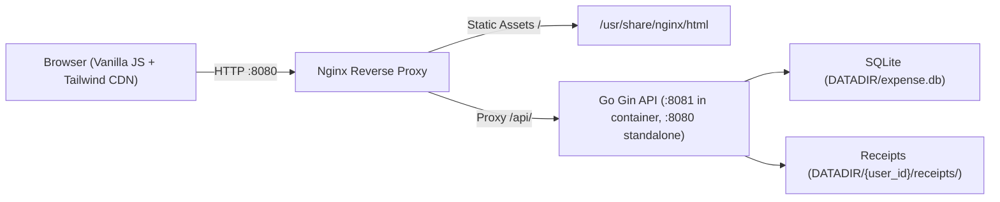

# Expense App

[](https://www.buymeacoffee.com/jmrenouard)

A lightweight expense tracking application built with a Go REST API (`Gin` + `SQLite` via `go-sqlite3`), an Nginx reverse proxy, and a Vanilla JavaScript + Tailwind CSS frontend (`frontend/`).

## Documentation Portals

- **English Diátaxis Documentation**: [docs/index.md](docs/index.md) ([Tutorials](docs/01-tutorials/index.md) | [How-To Guides](docs/02-how-to-guides/index.md) | [Reference](docs/03-reference/index.md) | [Explanation](docs/04-explanation/index.md)) — [Technical Specifications](SPECIFICATIONS.md)
- **Documentation Diátaxis en français** : [docs/fr/index.md](docs/fr/index.md) ([Tutoriels](docs/fr/01-tutoriels/index.md) | [Guides pratiques](docs/fr/02-guides-pratiques/index.md) | [Référence](docs/fr/03-reference/index.md) | [Explications](docs/fr/04-explications/index.md)) — [Spécifications techniques](SPECIFICATIONS_FR.md)

## Architecture



## Getting Started

Run the containerized stack with Docker and `Makefile`, or launch the Go server directly on your host.

### Option A: Docker Container (Recommended)

1. Build and start the container (`Nginx` listens on `:8080` and forwards `/api/` to Go on `:8081`):

   ```bash
   make build
   make run
   ```

2. Open `http://localhost:8080` in your browser and sign in with the configured super-admin credentials.

### Option B: Run Standalone Go Backend

```bash
go mod download
CGO_ENABLED=1 go run .
```

When started outside Docker, `main.go` listens directly on `:8080` (`PORT` defaults to `8080`) and initializes `./data/expense.db`.

## Makefile Commands

| Target | Action |
| --- | --- |
| `make build` | Build the `expenseapp` Docker image (`Dockerfile`). |
| `make run` | Start container `expenseapp` publishing `8080:8080` and mounting `$(PWD)/data:/data`. |
| `make stop` | Stop and remove the `expenseapp` container. |
| `make logs` | Stream container logs. |
| `make clean` | Stop the container and remove the `expenseapp` Docker image. |
| `make test` | Run unit tests and containerized functional tests. |
| `make test-unit` | Run `go test -v .`. |
| `make test-functional` | Build app + test images (`tests/Dockerfile`) and verify `POST /api/auth/login`. |

## Configuration

| Variable | Description | Standalone Default (`main.go`) | Docker Default (`Dockerfile`) |
| --- | --- | --- | --- |
| `PORT` | TCP listening port for the Go HTTP server. | `8080` | `8081` (proxied via Nginx `:8080`) |
| `DATADIR` | Directory storing `expense.db` and uploaded receipt files. | `./data` | `/data` |
| `JWT_SECRET` | HMAC secret key used to sign JWTs (`HS256`, 24h expiry). Change in production. | `secret` | `secret` |
| `ADMIN_EMAIL` | Email for the initial seeded `Administrateurs` account (`users` empty). | `admin@example.com` | `admin@example.com` |
| `ADMIN_PASSWORD` | Password for the initial seeded super-admin account. Change immediately. | `admin` | `admin` |

### Example with `docker run`

```bash
docker build -t expenseapp:latest .
docker run -d \
  -p 8080:8080 \
  -e PORT=8081 \
  -e DATADIR=/data \
  -e ADMIN_EMAIL=myadmin@example.com \
  -e ADMIN_PASSWORD=replace-with-strong-password \
  -e JWT_SECRET=replace-with-strong-jwt-secret \
  -v $(pwd)/data:/data \
  --name expense-app \
  expenseapp:latest
```
