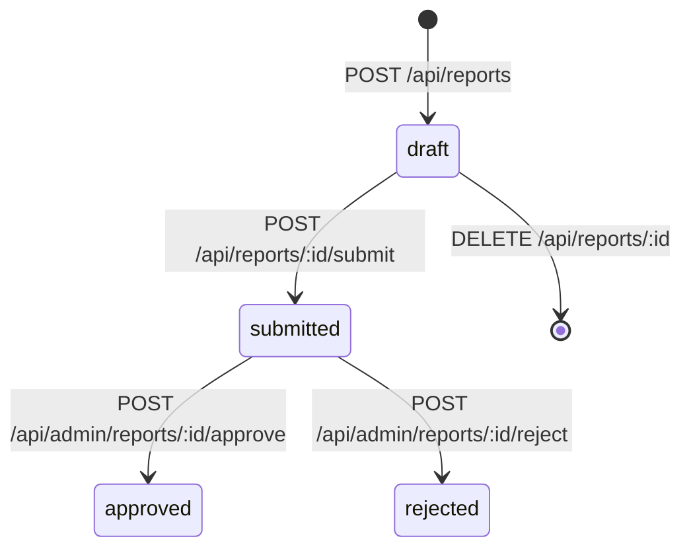

# Detailed Functional & Technical Specifications (DFTS)

For task-oriented documentation and operational runbooks, browse the [English Diátaxis Portal](docs/index.md). For the French version, see [SPECIFICATIONS_FR.md](SPECIFICATIONS_FR.md).

## Expense Report Management Application

### 1. Introduction and Objectives

#### 1.1. Project Context

This document defines the functional and technical specifications for the Expense Report Management web application (`expenseapp`). It reconciles original requirements against the current Go, SQLite, Nginx, and Vanilla JavaScript implementation.

#### 1.2. Main Objectives

* **Simplify Data Entry:** Allow users to create draft expense reports and attach itemized expenses.
* **Centralize Receipts:** Store uploaded receipt attachments per user under `DATADIR/{user_id}/receipts/`.
* **Ensure Traceability:** Compute and store tax-excluded (`amount_ht`), VAT (`vat_rate`), and tax-included (`amount_ttc = amount_ht * (1 + vat_rate)`) totals.
* **Enforce Group RBAC:** Guard all protected endpoints with group-based permissions (`RequirePermission`).
* **Manage Approval Workflow:** Track expense reports across `draft`, `submitted`, `approved`, and `rejected` states.
* **Provide Structured Exports:** Export reports via CSV, JSON, and YAML endpoints (PDF export remains on the roadmap).

### 2. Functional Specifications

#### 2.1. User Journeys

* **Standard User (`Utilisateurs`):** Create, edit, attach receipts to, submit, and delete own `draft` expense reports (`reports:create`, `reports:update:own`, `reports:read:own`).
* **Validator (`Validateurs`):** List non-draft reports and approve or reject submitted reports (`reports:read:all`, `reports:approve`, `reports:reject`).
* **Super Administrator (`Administrateurs`):** Manage users, groups, group permissions, static token generation, and global exports (holds all `13` permissions).

#### 2.2. Feature Description

##### 2.2.1. Validation Workflow and Statuses

The `status` column in `expense_reports` follows this state machine enforced by `handlers.go`:

##### 2.2.2. Seeded Predefined Groups (`models.go`)

`InitDB()` seeds three predefined French-named groups and `13` permissions on startup:

* **`Administrateurs`:** Assigned all `13` permissions.
* **`Validateurs`:** Assigned `reports:read:all`, `reports:approve`, `reports:reject`.
* **`Utilisateurs`:** Assigned `reports:create`, `reports:update:own`, `reports:read:own`.

##### 2.2.3. Data Export Scope

* **Implemented Admin Exports:** `GET /api/admin/export/csv`, `GET /api/admin/export/json`, and `GET /api/admin/export/yaml` (`reports:export:all`).
* **Planned (Not Yet Implemented):** Per-report PDF export (`gofpdf`).

### 3. Technical Specifications

#### 3.1. Architecture and Security

* **Frontend (`frontend/`):** Vanilla JavaScript (`ES6+`) SPA styled via Tailwind CSS CDN (`frontend/index.html`, `frontend/main.js`). Workbox offline PWA support is a roadmap item.
* **Backend (`main.go`, `handlers.go`):** Go `1.20+` Gin REST API listening on `:8080` directly or `:8081` behind Nginx (`Dockerfile`).
* **Authentication (`auth.go`, `middleware.go`):** Signed `HS256` JWTs (`24h` TTL) via `Authorization: Bearer <token>`. Note: `POST /api/admin/users/:id/token` generates hex keys in `api_tokens`, while `AuthMiddleware` currently rejects `X-API-Key` with `401 {"error": "API keys not supported"}` until lookup middleware is wired.
* **Passwords:** Hashed using `bcrypt.DefaultCost` (`golang.org/x/crypto/bcrypt`).

##### 3.1.1. Receipts Storage and `DATADIR`

* **Data Directory (`DATADIR`):** Configurable via `DATADIR` env var (defaults to `./data` standalone, `/data` in Docker). Stores `expense.db`.
* **Structure:** `DATADIR/{user_id}/receipts/{item_id}{ext}` (lowercase extension preserved).
* **Database Column:** `expense_items.receipt_path` stores only `{item_id}{ext}`; `GET /api/items/:id/receipt` reconstructs the path after checking ownership or `reports:read:all`.

#### 3.2. Database Schema (SQLite)

```mermaid
erDiagram
    USERS {
        int id PK
        string email
        string password_hash
        datetime created_at
    }
    GROUPS {
        int id PK
        string name
    }
    PERMISSIONS {
        int id PK
        string action
    }
    USER_GROUPS {
        int user_id PK
        int group_id PK
    }
    GROUP_PERMISSIONS {
        int group_id PK
        int permission_id PK
    }
    EXPENSE_REPORTS {
        int id PK
        int user_id FK
        string title
        string status
        datetime created_at
    }
    EXPENSE_ITEMS {
        int id PK
        int report_id FK
        string description
        date expense_date
        float amount_ht
        float amount_ttc
        float vat_rate
        string receipt_path
        datetime created_at
    }
    USERS ||--|{ USER_GROUPS : "belongs to"
    GROUPS ||--|{ USER_GROUPS : "contains"
    GROUPS ||--|{ GROUP_PERMISSIONS : "has"
    PERMISSIONS ||--|{ GROUP_PERMISSIONS : "assigned to"
    USERS ||--o{ EXPENSE_REPORTS : "creates"
    EXPENSE_REPORTS ||--o{ EXPENSE_ITEMS : "contains"
```

#### 3.3. REST API (Implemented Endpoints in `main.go`)

| Category | HTTP Method | Path | Handler | Required Permission |
| --- | --- | --- | --- | --- |
| **Authentication** | `POST` | `/api/auth/login` | `Login` | Public |
| **Reports** | `POST` | `/api/reports` | `CreateReport` | `reports:create` |
| **Reports** | `GET` | `/api/reports` | `ListOwnReports` | `reports:read:own` |
| **Reports** | `POST` | `/api/reports/:id/submit` | `SubmitReport` | `reports:update:own` |
| **Reports** | `DELETE` | `/api/reports/:id` | `DeleteReport` | `reports:update:own` |
| **Items & Receipts** | `POST` | `/api/reports/:id/items` | `AddItem` | `reports:create` |
| **Items & Receipts** | `PUT` | `/api/items/:id` | `UpdateItem` | `reports:update:own` |
| **Items & Receipts** | `POST` | `/api/items/:id/receipt` | `UploadReceipt` | `reports:update:own` |
| **Items & Receipts** | `GET` | `/api/items/:id/receipt` | `GetReceipt` | `reports:read:own` (+ `reports:read:all` for non-owners) |
| **Administration** | `GET` | `/api/admin/reports` | `AdminListReports` | `reports:read:all` |
| **Administration** | `POST` | `/api/admin/reports/:id/approve` | `ApproveReport` | `reports:approve` |
| **Administration** | `POST` | `/api/admin/reports/:id/reject` | `RejectReport` | `reports:reject` |
| **Administration** | `GET` | `/api/admin/users` | `ListUsers` | `users:read` |
| **Administration** | `POST` | `/api/admin/users` | `CreateUser` | `users:create` |
| **Administration** | `GET` | `/api/admin/groups` | `ListGroups` | `groups:read` |
| **Administration** | `POST` | `/api/admin/groups` | `CreateGroup` | `groups:create` |
| **Administration** | `POST` | `/api/admin/groups/:id/permissions` | `AssignPermissions` | `permissions:assign` |
| **Administration** | `POST` | `/api/admin/users/:id/token` | `GenerateAPIToken` | `tokens:create` |
| **Exports** | `GET` | `/api/admin/export/csv` | `ExportCSV` | `reports:export:all` |
| **Exports** | `GET` | `/api/admin/export/json` | `ExportJSON` | `reports:export:all` |
| **Exports** | `GET` | `/api/admin/export/yaml` | `ExportYAML` | `reports:export:all` |

#### 3.4. Technology Stack Status

| Domain | Component | Tool / Library | Implementation Status |
| --- | --- | --- | --- |
| **Backend** | Web Framework | Gin (`github.com/gin-gonic/gin v1.9.1`) | Active (`main.go`, `handlers.go`) |
| **Backend** | Database | `database/sql` + `go-sqlite3 v1.14.18` (CGO) | Active (`models.go`) |
| **Backend** | JWT Auth | `github.com/golang-jwt/jwt/v5` | Active (`auth.go`, `middleware.go`) |
| **Backend** | Password Hash | `golang.org/x/crypto/bcrypt` | Active (`auth.go`) |
| **Backend** | YAML Export | `gopkg.in/yaml.v3` | Active (`handlers.go`) |
| **Backend** | PDF Export | `gofpdf` (planned) | Not yet implemented |
| **Frontend** | SPA & Styling | Vanilla JS (`ES6+`) + Tailwind CSS CDN | Active (`frontend/index.html`, `frontend/main.js`) |
| **Frontend** | Offline PWA | Workbox (planned) | Not yet implemented |
| **Tests** | Go & Docs Tests | `testing` + `testify` + Python `unittest` | Active (`auth_test.go`, `docs_tutorials_howtos_test.go`, `tests/`) |
| **Tooling** | Containers & CI | Docker, Nginx proxy, Make, GitHub Actions | Active (`Dockerfile`, `ci.yml`, `lint.yml`) |
| **Tooling** | OpenAPI Spec | Swaggo (planned) | Not yet implemented |
