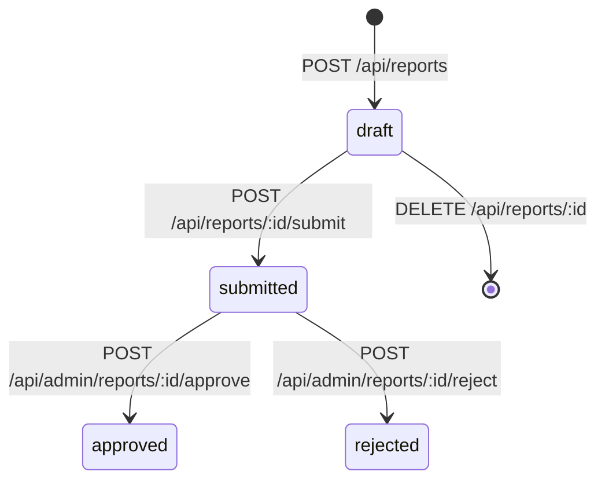
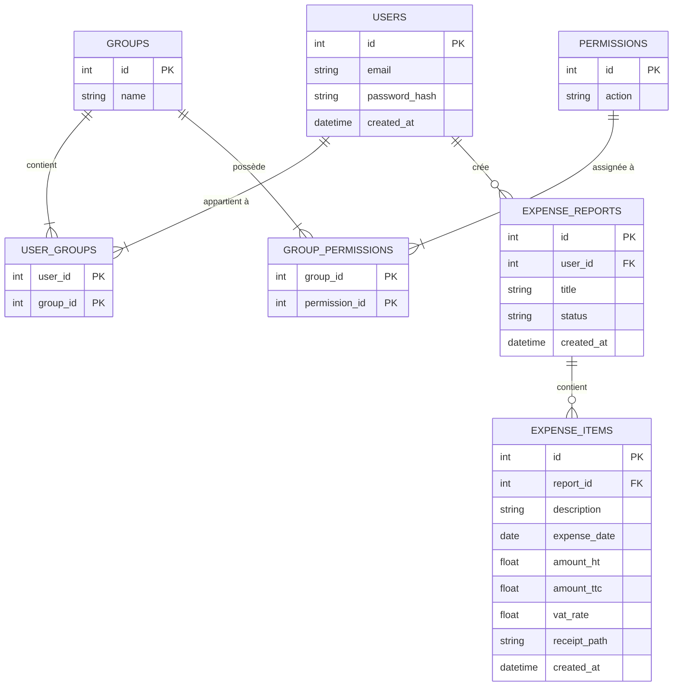

# Spécifications Fonctionnelles & Techniques Détaillées (SFTD)

Pour les parcours guidés et procédures opérationnelles, consultez le [Portail Diátaxis FR](docs/fr/index.md). Pour la version anglaise, consultez [SPECIFICATIONS.md](SPECIFICATIONS.md).

## Application de Gestion de Notes de Frais

### 1. Introduction et Objectifs

#### 1.1. Contexte du projet

Ce document définit les spécifications fonctionnelles et techniques de l'application web de gestion de notes de frais (`expenseapp`) et maintient l'alignement exact avec l'implémentation Go, SQLite, Nginx et JavaScript.

#### 1.2. Objectifs principaux

* **Simplifier la saisie :** Permettre aux utilisateurs de créer des notes de frais en brouillon et d'y ajouter des dépenses.
* **Centraliser les justificatifs :** Conserver une pièce jointe par dépense dans `DATADIR/{user_id}/receipts/`.
* **Assurer la traçabilité :** Calculer et stocker les montants HT (`amount_ht`), taux de TVA (`vat_rate`) et TTC (`amount_ttc = amount_ht * (1 + vat_rate)`).
* **Gérer les permissions par groupe :** Contrôler chaque route sensible via `RequirePermission`.
* **Suivre le workflow de validation :** Gérer les statuts `draft`, `submitted`, `approved` et `rejected`.
* **Permettre l'export :** Fournir les exports administrateur en CSV, JSON et YAML (l'export PDF reste sur la feuille de route).

### 2. Spécifications Fonctionnelles

#### 2.1. Parcours Utilisateur

* **Utilisateur standard (`Utilisateurs`) :** Créer, modifier, joindre des justificatifs, soumettre et supprimer ses propres notes `draft` (`reports:create`, `reports:update:own`, `reports:read:own`).
* **Validateur (`Validateurs`) :** Consulter les notes non brouillon et approuver ou rejeter les notes soumises (`reports:read:all`, `reports:approve`, `reports:reject`).
* **Super Administrateur (`Administrateurs`) :** Gérer utilisateurs, groupes, permissions, génération de tokens et exports globaux (détient l'ensemble des `13` permissions).

#### 2.2. Description des fonctionnalités

##### 2.2.1. Workflow de Validation et Statuts

La colonne `status` de la table `expense_reports` suit ce cycle de vie dans `handlers.go` :

##### 2.2.2. Groupes Prédéfinis (`models.go`)

La fonction `InitDB()` initialise trois groupes et `13` permissions atomiques au démarrage :

* **`Administrateurs` :** Ensemble des `13` permissions.
* **`Validateurs` :** `reports:read:all`, `reports:approve`, `reports:reject`.
* **`Utilisateurs` :** `reports:create`, `reports:update:own`, `reports:read:own`.

##### 2.2.3. Périmètre des Exports

* **Exports implémentés :** `GET /api/admin/export/csv`, `GET /api/admin/export/json` et `GET /api/admin/export/yaml` (`reports:export:all`).
* **Prévu (non implémenté) :** Export PDF individuel (`gofpdf`).

### 3. Spécifications Techniques

#### 3.1. Architecture et Sécurité

* **Frontend (`frontend/`) :** Application monopage en JavaScript natif (`ES6+`) stylisée via Tailwind CSS CDN (`frontend/index.html`, `frontend/main.js`). Le support hors-ligne Workbox figure en feuille de route.
* **Backend (`main.go`, `handlers.go`) :** API REST Go `1.20+` avec `Gin` écoutant sur `:8080` en exécution directe ou sur `:8081` derrière le proxy Nginx (`Dockerfile`).
* **Authentification (`auth.go`, `middleware.go`) :** Jetons JWT signés `HS256` (validité `24h`) transmis via `Authorization: Bearer <token>`. Remarque : `POST /api/admin/users/:id/token` insère un jeton hexadécimal dans `api_tokens`, mais `AuthMiddleware` renvoie actuellement `401 {"error": "API keys not supported"}` pour `X-API-Key`.
* **Mots de passe :** Hachage `bcrypt.DefaultCost` (`golang.org/x/crypto/bcrypt`).

##### 3.1.1. Stockage des Justificatifs et `DATADIR`

* **Répertoire de données (`DATADIR`) :** Variable d'environnement `DATADIR` (`./data` par défaut en local, `/data` dans Docker) contenant `expense.db`.
* **Arborescence :** `DATADIR/{user_id}/receipts/{item_id}{ext}` (extension en minuscules).
* **Base SQLite :** `expense_items.receipt_path` stocke uniquement `{item_id}{ext}` ; `GET /api/items/:id/receipt` reconstruit le chemin après vérification du propriétaire ou de `reports:read:all`.

#### 3.2. Schéma de la Base de Données (SQLite)

#### 3.3. API REST (Routes implémentées dans `main.go`)

| Catégorie | Méthode HTTP | Route | Handler | Permission requise |
| --- | --- | --- | --- | --- |
| **Authentification** | `POST` | `/api/auth/login` | `Login` | Publique |
| **Notes de frais** | `POST` | `/api/reports` | `CreateReport` | `reports:create` |
| **Notes de frais** | `GET` | `/api/reports` | `ListOwnReports` | `reports:read:own` |
| **Notes de frais** | `POST` | `/api/reports/:id/submit` | `SubmitReport` | `reports:update:own` |
| **Notes de frais** | `DELETE` | `/api/reports/:id` | `DeleteReport` | `reports:update:own` |
| **Dépenses et justificatifs** | `POST` | `/api/reports/:id/items` | `AddItem` | `reports:create` |
| **Dépenses et justificatifs** | `PUT` | `/api/items/:id` | `UpdateItem` | `reports:update:own` |
| **Dépenses et justificatifs** | `POST` | `/api/items/:id/receipt` | `UploadReceipt` | `reports:update:own` |
| **Dépenses et justificatifs** | `GET` | `/api/items/:id/receipt` | `GetReceipt` | `reports:read:own` (+ `reports:read:all` hors propriétaire) |
| **Administration** | `GET` | `/api/admin/reports` | `AdminListReports` | `reports:read:all` |
| **Administration** | `POST` | `/api/admin/reports/:id/approve` | `ApproveReport` | `reports:approve` |
| **Administration** | `POST` | `/api/admin/reports/:id/reject` | `RejectReport` | `reports:reject` |
| **Administration** | `GET` | `/api/admin/users` | `ListUsers` | `users:read` |
| **Administration** | `POST` | `/api/admin/users` | `CreateUser` | `users:create` |
| **Administration** | `GET` | `/api/admin/groups` | `ListGroups` | `groups:read` |
| **Administration** | `POST` | `/api/admin/groups` | `CreateGroup` | `groups:create` |
| **Administration** | `POST` | `/api/admin/groups/:id/permissions` | `AssignPermissions` | `permissions:assign` |
| **Administration** | `POST` | `/api/admin/users/:id/token` | `GenerateAPIToken` | `tokens:create` |
| **Exports** | `GET` | `/api/admin/export/csv` | `ExportCSV` | `reports:export:all` |
| **Exports** | `GET` | `/api/admin/export/json` | `ExportJSON` | `reports:export:all` |
| **Exports** | `GET` | `/api/admin/export/yaml` | `ExportYAML` | `reports:export:all` |

#### 3.4. État réel des technologies

| Domaine | Composant | Outil / Bibliothèque | État |
| --- | --- | --- | --- |
| **Backend** | Framework Web | Gin (`github.com/gin-gonic/gin v1.9.1`) | Actif (`main.go`, `handlers.go`) |
| **Backend** | Base de données | `database/sql` + `go-sqlite3 v1.14.18` (CGO) | Actif (`models.go`) |
| **Backend** | Authentification JWT | `github.com/golang-jwt/jwt/v5` | Actif (`auth.go`, `middleware.go`) |
| **Backend** | Hachage | `golang.org/x/crypto/bcrypt` | Actif (`auth.go`) |
| **Backend** | Export YAML | `gopkg.in/yaml.v3` | Actif (`handlers.go`) |
| **Backend** | Export PDF | `gofpdf` (prévu) | Non implémenté |
| **Frontend** | SPA et styles | Vanilla JS (`ES6+`) + Tailwind CSS CDN | Actif (`frontend/index.html`, `frontend/main.js`) |
| **Frontend** | PWA hors-ligne | Workbox (prévu) | Non implémenté |
| **Tests** | Tests Go et Docs | `testing` + `testify` + Python `unittest` | Actif (`auth_test.go`, `docs_tutorials_howtos_test.go`, `tests/`) |
| **Outillage** | Conteneurs et CI | Docker, proxy Nginx, Make, GitHub Actions | Actif (`Dockerfile`, `ci.yml`, `lint.yml`) |
| **Outillage** | Documentation OpenAPI | Swaggo (prévu) | Non implémenté |
