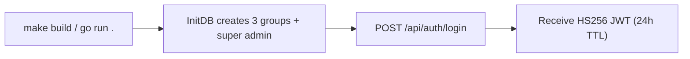

# Quickstart with Docker and Local Go Runtime

In this tutorial, you build and launch `expenseapp` locally and verify authentication against `/api/auth/login`.



## Prerequisites

- Docker and `make` (or Go `1.20+` with CGO C compiler tools such as `gcc` and `musl-dev`).
- `curl` for HTTP API checks.

## 1. Run Directly with Go (Host Mode)

Launch the backend directly on port `8080` with custom credentials:

```bash
export PORT=8080
export DATADIR=./data
export JWT_SECRET=dev-local-jwt-secret
export ADMIN_EMAIL=admin@example.com
export ADMIN_PASSWORD=admin
CGO_ENABLED=1 go run .
```

Expected startup log line:

```text
[INFO] Super admin created with email admin@example.com and password admin
Server listening on :8080
```

## 2. Or Run via Docker and Makefile

```bash
make build
make run
```

Inside the container, Nginx listens on `:8080` and proxies `/api/` to Go on `127.0.0.1:8081`.

## 3. Obtain a JWT Token

```bash
curl -s -X POST http://localhost:8080/api/auth/login \
  -H "Content-Type: application/json" \
  -d '{"email":"admin@example.com","password":"admin"}'
```

Response contains `token` and `user` (`{"id": 1, "email": "admin@example.com"}`).

## Cleanup

```bash
make clean
rm -rf ./data
```

Continue with [Expense Report Lifecycle Lab](02-expense-report-lifecycle-lab.md).
