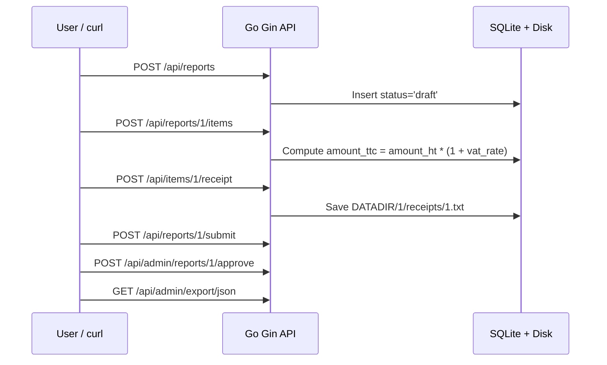

# Expense Report Lifecycle Lab

In this tutorial, you walk through creating a draft expense report, adding VAT items, attaching a receipt, submitting, approving, and exporting data.



## 1. Authenticate and Export `TOKEN`

```bash
TOKEN=$(curl -s -X POST http://localhost:8080/api/auth/login \
  -H "Content-Type: application/json" \
  -d '{"email":"admin@example.com","password":"admin"}' | python3 -c "import sys,json; print(json.load(sys.stdin)['token'])")
```

## 2. Create a Draft Report

```bash
curl -s -X POST http://localhost:8080/api/reports \
  -H "Authorization: Bearer $TOKEN" \
  -H "Content-Type: application/json" \
  -d '{"title":"August Client Travel"}'
```

## 3. Add an Expense Item and Upload a Receipt

The API calculates `amount_ttc = 100.0 * (1 + 0.20) = 120.0`:

```bash
curl -s -X POST http://localhost:8080/api/reports/1/items \
  -H "Authorization: Bearer $TOKEN" \
  -H "Content-Type: application/json" \
  -d '{"description":"Train ticket","expense_date":"2026-08-12","amount_ht":100.0,"vat_rate":0.20}'

echo "sample receipt" > /tmp/receipt.txt
curl -s -X POST http://localhost:8080/api/items/1/receipt \
  -H "Authorization: Bearer $TOKEN" \
  -F "file=@/tmp/receipt.txt"
```

Download the stored receipt back via `GET /api/items/1/receipt`:

```bash
curl -s -H "Authorization: Bearer $TOKEN" http://localhost:8080/api/items/1/receipt
```

## 4. Submit, Approve, and Export

```bash
curl -s -X POST -H "Authorization: Bearer $TOKEN" http://localhost:8080/api/reports/1/submit
curl -s -X POST -H "Authorization: Bearer $TOKEN" http://localhost:8080/api/admin/reports/1/approve
curl -s -H "Authorization: Bearer $TOKEN" http://localhost:8080/api/admin/export/csv
curl -s -H "Authorization: Bearer $TOKEN" http://localhost:8080/api/admin/export/yaml
```

## Next Steps

- Review [REST API and Permissions](../03-reference/01-rest-api-and-permissions.md) and [RBAC and Workflow Design](../04-explanation/01-rbac-and-workflow-design.md).
