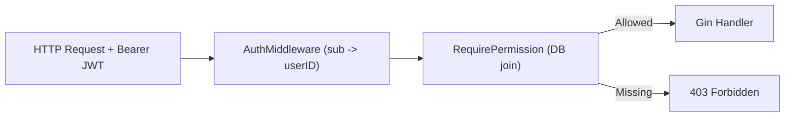

# RBAC and Workflow Design

`expenseapp` separates user identity (`users`), role groups (`groups`), and fine-grained route capabilities (`permissions`) using SQLite join tables.

## Group-Based Authorization (`permissions.go`)

Every protected route wraps its handler in `RequirePermission(db, action)`, which joins `permissions`, `group_permissions`, and `user_groups` at request time. Consequently, adding a permission to a group takes effect immediately without requiring users to re-login or reissue JWTs.

## Ownership and State Guards

In addition to group permissions, handlers enforce record-level ownership and workflow state invariants:

- Users can add/edit items, upload receipts, submit, or delete a report **only** when `user_id == ownerID` and `status == "draft"`.
- Validators (`Validateurs`) can inspect non-draft reports and transition only `submitted` reports to `approved` or `rejected`.
- Non-owners accessing `GET /api/items/:id/receipt` require the `reports:read:all` permission.
