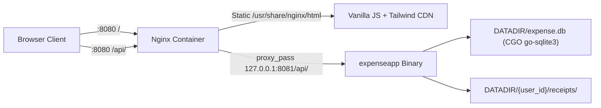

# Storage, Proxy, and Security Posture

`expenseapp` packages both static web assets and the Go REST API inside one Nginx-fronted Alpine container (`Dockerfile`).

## Storage Layout and Receipt Isolation

Setting `DATADIR` (default `./data` on host, `/data` inside Docker) keeps SQLite state (`expense.db`) and uploaded binary receipts under one mount point. Renaming receipts to `{item_id}{ext}` inside `{user_id}/receipts/` prevents client filename collisions and stores only the basename in `expense_items.receipt_path`.

## Observed Security Boundaries

- **Default Credentials & Secret Fallbacks**: When `JWT_SECRET`, `ADMIN_EMAIL`, and `ADMIN_PASSWORD` are unset, `auth.go` and `models.go` fall back to `secret` / `admin@example.com` / `admin`, and `InitDB` prints the seeded credentials to stdout. Production deployments must override all three variables before first start.
- **Static API Tokens (`X-API-Key`)**: `GenerateAPIToken` writes hex keys to `api_tokens`, while `AuthMiddleware` intentionally rejects `X-API-Key` headers with `401` until token validation against `api_tokens` is implemented.
