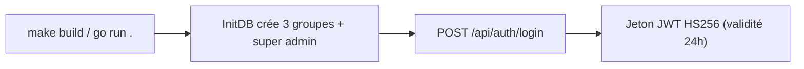

# Démarrage avec Docker et exécution locale

Dans ce tutoriel, vous compilez et démarrez `expenseapp` en local puis validez l'authentification sur `/api/auth/login`.



## Prérequis

- Docker et GNU Make (ou Go `1.20+` avec outils C pour CGO tels que `gcc` et `musl-dev`).
- `curl` pour exécuter les requêtes HTTP.

## 1. Lancer directement avec Go sur l'hôte

Démarrez le backend sur le port `8080` :

```bash
export PORT=8080
export DATADIR=./data
export JWT_SECRET=dev-local-jwt-secret
export ADMIN_EMAIL=admin@example.com
export ADMIN_PASSWORD=admin
CGO_ENABLED=1 go run .
```

Sortie attendue au premier démarrage :

```text
[INFO] Super admin created with email admin@example.com and password admin
Server listening on :8080
```

## 2. Ou lancer avec Docker et Makefile

```bash
make build
make run
```

Dans le conteneur, Nginx écoute sur `:8080` et proxifie `/api/` vers Go sur `127.0.0.1:8081`.

## 3. Obtenir un jeton JWT

```bash
curl -s -X POST http://localhost:8080/api/auth/login \
  -H "Content-Type: application/json" \
  -d '{"email":"admin@example.com","password":"admin"}'
```

La réponse JSON contient les champs `token` et `user` (`{"id": 1, "email": "admin@example.com"}`).

## Nettoyage

```bash
make clean
rm -rf ./data
```

Poursuivez avec [Laboratoire cycle de vie d'une note de frais](02-cycle-vie-note-de-frais.md).
