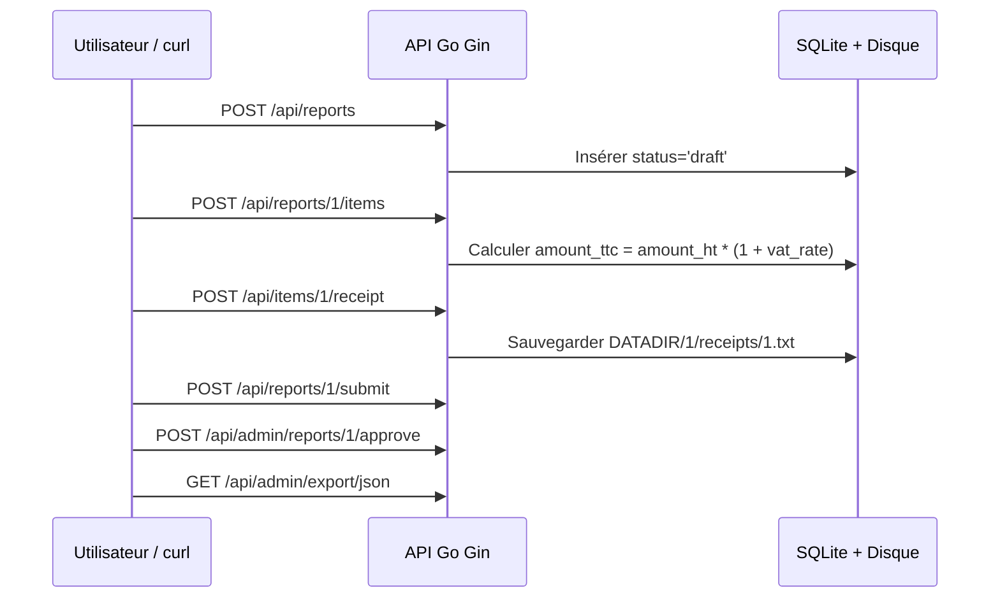

# Laboratoire cycle de vie d'une note de frais

Dans ce tutoriel, vous créez un brouillon, ajoutez une ligne de dépense avec TVA, joignez un justificatif, soumettez la note, la validez et exportez les données.



## 1. S'authentifier et exporter `TOKEN`

```bash
TOKEN=$(curl -s -X POST http://localhost:8080/api/auth/login \
  -H "Content-Type: application/json" \
  -d '{"email":"admin@example.com","password":"admin"}' | python3 -c "import sys,json; print(json.load(sys.stdin)['token'])")
```

## 2. Créer une note de frais en brouillon

```bash
curl -s -X POST http://localhost:8080/api/reports \
  -H "Authorization: Bearer $TOKEN" \
  -H "Content-Type: application/json" \
  -d '{"title":"Déplacement client août"}'
```

## 3. Ajouter une dépense et téléverser un justificatif

L'API calcule `amount_ttc = 100.0 * (1 + 0.20) = 120.0` :

```bash
curl -s -X POST http://localhost:8080/api/reports/1/items \
  -H "Authorization: Bearer $TOKEN" \
  -H "Content-Type: application/json" \
  -d '{"description":"Billet de train","expense_date":"2026-08-12","amount_ht":100.0,"vat_rate":0.20}'

echo "justificatif test" > /tmp/receipt.txt
curl -s -X POST http://localhost:8080/api/items/1/receipt \
  -H "Authorization: Bearer $TOKEN" \
  -F "file=@/tmp/receipt.txt"
```

Téléchargez le justificatif stocké via `GET /api/items/1/receipt` :

```bash
curl -s -H "Authorization: Bearer $TOKEN" http://localhost:8080/api/items/1/receipt
```

## 4. Soumettre, approuver et exporter

```bash
curl -s -X POST -H "Authorization: Bearer $TOKEN" http://localhost:8080/api/reports/1/submit
curl -s -X POST -H "Authorization: Bearer $TOKEN" http://localhost:8080/api/admin/reports/1/approve
curl -s -H "Authorization: Bearer $TOKEN" http://localhost:8080/api/admin/export/csv
curl -s -H "Authorization: Bearer $TOKEN" http://localhost:8080/api/admin/export/yaml
```

## Prochaines étapes

- Consultez [API REST et permissions](../03-reference/01-api-rest-et-permissions.md) et [Architecture RBAC et workflow](../04-explications/01-architecture-rbac-et-workflow.md).
