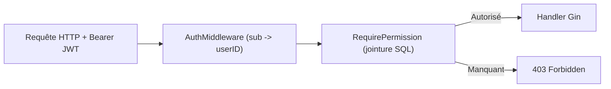

# Architecture RBAC et workflow

`expenseapp` dissocie l'identité des utilisateurs (`users`), les groupes (`groups`) et les permissions atomiques (`permissions`) via des tables de jointure SQLite.

## Autorisation par groupes (`permissions.go`)

Chaque route protégée vérifie `RequirePermission(db, action)` en interrogeant `permissions`, `group_permissions` et `user_groups` à chaque requête. Toute modification de permission sur un groupe prend donc effet immédiatement sans réémission de jeton JWT.

## Contrôles de propriété et d'état

En complément du RBAC, les handlers imposent des invariants stricts :

- Seul le propriétaire d'une note à l'état `draft` peut ajouter ou modifier une dépense, téléverser un justificatif, soumettre ou supprimer cette note.
- Les membres du groupe `Validateurs` consultent les notes non brouillon et ne peuvent valider ou rejeter que l'état `submitted`.
- L'accès à un justificatif d'un autre utilisateur via `GET /api/items/:id/receipt` exige `reports:read:all`.
