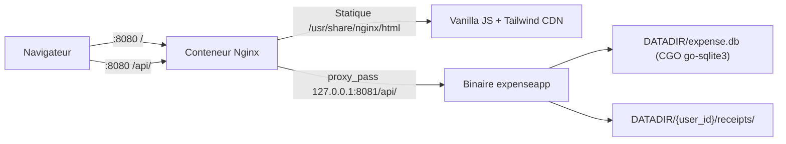

# Stockage, proxy et sécurité

`expenseapp` réunit les ressources statiques frontend et le binaire API Go dans un conteneur Alpine unique exposé par Nginx (`Dockerfile`).

## Organisation du stockage et des justificatifs

La variable `DATADIR` (`./data` sur hôte, `/data` dans Docker) centralise la base SQLite (`expense.db`) et les pièces jointes sous un même volume persistant. Le renommage en `{item_id}{ext}` dans `{user_id}/receipts/` évite les collisions de noms tout en ne stockant que le nom court dans `expense_items.receipt_path`.

## Limites de sécurité observées

- **Secrets par défaut :** Sans surcharge de `JWT_SECRET`, `ADMIN_EMAIL` et `ADMIN_PASSWORD`, l'application utilise `secret` / `admin@example.com` / `admin` et journalise ces valeurs initiales sur stdout (`InitDB`). Définissez des secrets uniques avant tout démarrage exposé.
- **Clés API statiques (`X-API-Key`) :** `GenerateAPIToken` enregistre des clés hexadécimales dans `api_tokens`, mais `AuthMiddleware` retourne `401` tant que la vérification en base n'est pas activée.
