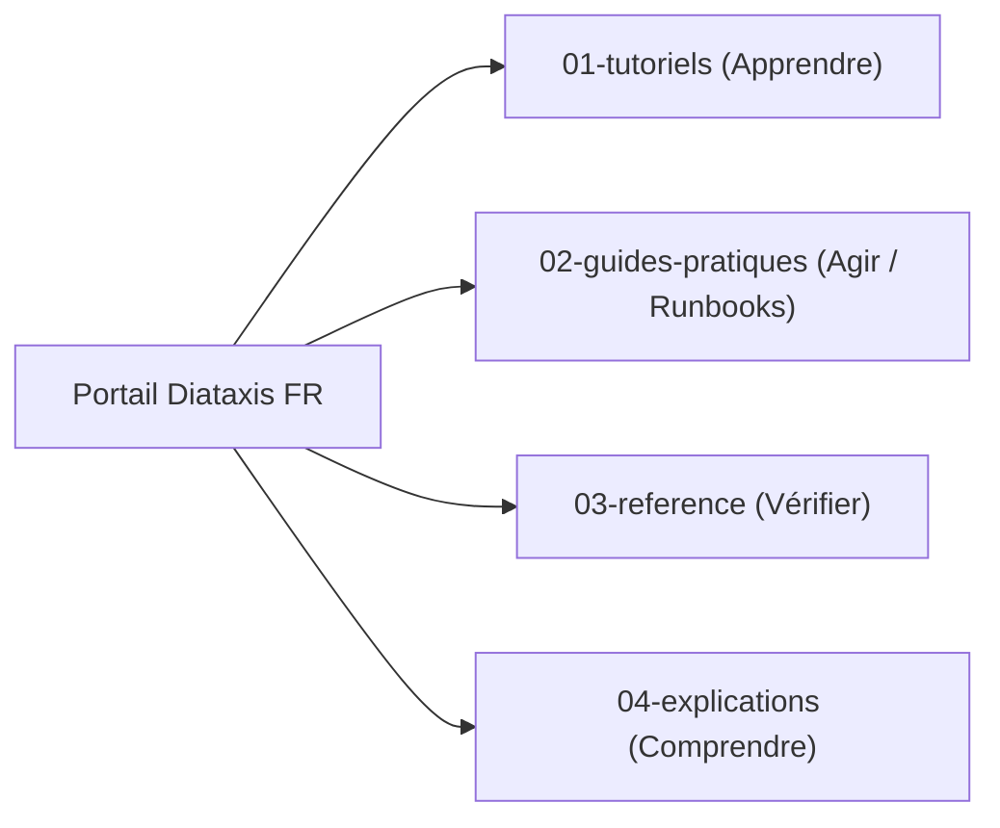

# Documentation Expense App (FR)

Documentation structurée en français pour `expenseapp`, organisée selon l'architecture Diátaxis.

## Quadrants

- [Tutoriels](01-tutoriels/index.md) : parcours guidés pour lancer la pile Docker et exécuter le cycle complet d'une note de frais.
- [Guides pratiques](02-guides-pratiques/index.md) : procédures opérationnelles ASD-STF100 pour déployer le conteneur, administrer les groupes/validations et exporter/sauvegarder SQLite.
- [Référence](03-reference/index.md) : tables de référence des 21 routes HTTP, des 13 permissions RBAC, du schéma SQLite, des variables d'environnement et du `Makefile`.
- [Explications](04-explications/index.md) : notes d'architecture sur le contrôle d'accès par groupes, les transitions d'état, le stockage et le proxy Nginx.

Voir aussi [Spécifications Techniques (SFTD)](../../SPECIFICATIONS_FR.md) et le [portail anglais](../index.md).
