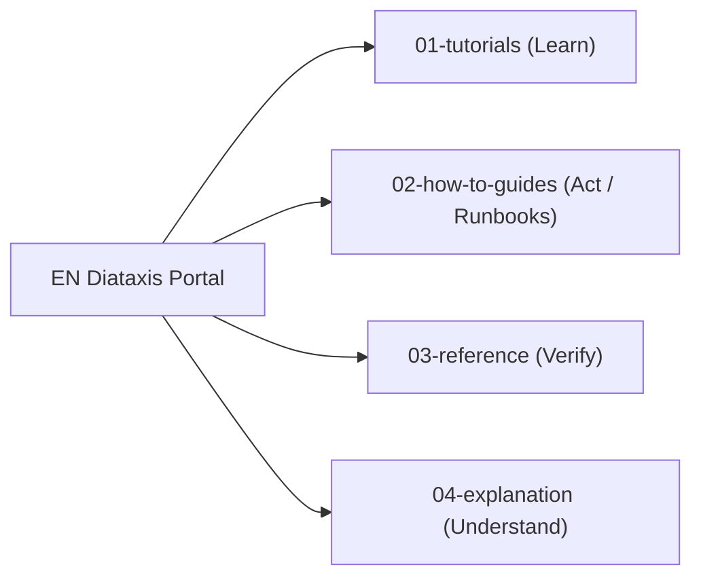

# Expense App Documentation (EN)

Structured English documentation for `expenseapp`, organized with the Diátaxis framework.

## Quadrants

- [Tutorials](01-tutorials/index.md): Guided walkthroughs for running the Docker stack and testing the full expense report API lifecycle.
- [How-To Guides](02-how-to-guides/index.md): Goal-oriented operational runbooks in ASD-STE100 Issue 9 covering container deployment, RBAC/approvals, and exports/backups.
- [Reference](03-reference/index.md): Lookup tables for all 21 HTTP endpoints, 13 RBAC permissions, SQLite schema, environment variables, and `Makefile` targets.
- [Explanation](04-explanation/index.md): Architectural notes on group RBAC, report state transitions, SQLite persistence, Nginx proxying, and security posture.

See also [Technical Specifications](../SPECIFICATIONS.md) and the [French Portal](fr/index.md).
